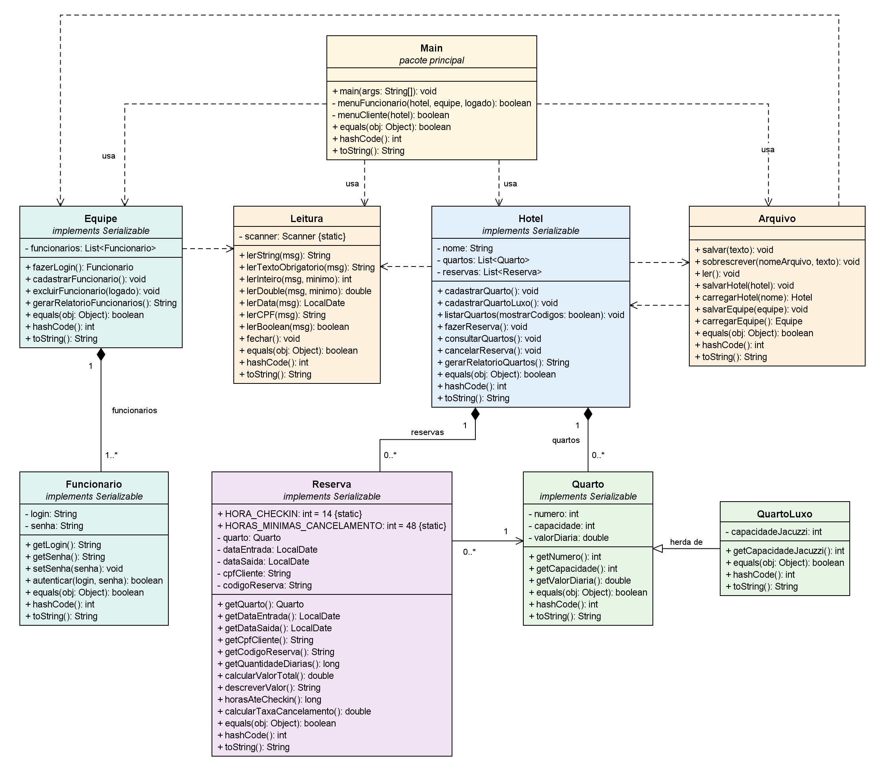

# Sistema de Reservas – Pousada do Sol e Mar

Projeto de conclusão da disciplina **Linguagem de Programação II (LPII)**.

Aplicação de console desenvolvida em Java e baseada nos princípios da **Programação Orientada a Objetos (POO)**. O sistema auxilia uma pousada no gerenciamento de quartos, reservas e funcionários, com áreas separadas para **funcionários** (acesso com login e senha) e **clientes**.

Os dados são armazenados em arquivo e recuperados automaticamente quando o programa é iniciado novamente.

## Funcionalidades

Ao iniciar, o sistema pergunta se o usuário é funcionário ou cliente:

| Opção | Perfil | Descrição |
|:---:|---|---|
| 1 | **Funcionário** | Pede login e senha. Se estiverem corretos, abre o menu do funcionário. |
| 2 | **Cliente** | Abre o menu do cliente, sem necessidade de login. |
| 0 | **Sair** | Encerra o programa. |

O sistema já vem com o funcionário padrão **ADMIN**, senha **123**.

### Menu do funcionário

| Opção | Funcionalidade | Descrição |
|:---:|---|---|
| 1 | **Cadastrar quarto** | Cadastra quartos comuns ou de luxo, com número, capacidade e valor da diária. Quartos de luxo possuem jacuzzi. |
| 2 | **Listar quartos** | Exibe todos os quartos cadastrados, os períodos reservados e os códigos das reservas. |
| 3 | **Consultar quarto** | Apresenta os dados de um quarto específico e todas as suas reservas, com o valor de cada uma. |
| 4 | **Cadastrar funcionário** | Cadastra um novo funcionário com login e senha, que passam a dar acesso ao menu do funcionário. |
| 5 | **Excluir funcionário** | Remove um funcionário após confirmação. |
| 9 | **Voltar** | Retorna à escolha entre funcionário e cliente. |
| 0 | **Sair** | Encerra o programa. |

### Menu do cliente

| Opção | Funcionalidade | Descrição |
|:---:|---|---|
| 1 | **Fazer reserva** | Solicita CPF, número do quarto e datas de entrada e saída. Verifica a disponibilidade, mostra o valor a pagar e, após a confirmação, gera um código de reserva de 6 dígitos. |
| 2 | **Cancelar reserva** | Cancela uma reserva a partir do código e do CPF usado na reserva. Pode haver taxa de cancelamento. |
| 3 | **Ver quartos disponíveis** | Exibe os quartos e os períodos já reservados, sem mostrar os códigos das reservas. |
| 9 | **Voltar** | Retorna à escolha entre funcionário e cliente. |
| 0 | **Sair** | Encerra o programa. |

## Regras de negócio

### Quartos e reservas

- O número de cada quarto deve ser único, mesmo entre quartos comuns e de luxo.
- A data de entrada não pode ser anterior à data atual.
- A data de saída deve ser posterior à data de entrada.
- Um quarto não pode possuir duas reservas com períodos conflitantes. A saída de um hóspede e a entrada de outro podem ocorrer no mesmo dia.
- As datas informadas devem ser válidas, impedindo entradas como `31/02/2026`.
- O CPF deve ter 11 dígitos e pode ser digitado com ou sem pontos e traço.
- Cada reserva recebe um código de identificação único de 6 dígitos.

### Valores

- **Valor a pagar** = quantidade de diárias × valor da diária do quarto. A quantidade de diárias é o número de noites entre a entrada e a saída.
- O valor é exibido antes da confirmação da reserva.
- **Taxa de cancelamento:** o cancelamento feito com menos de **48 horas** de antecedência do check-in, às **14h do dia da entrada**, tem taxa de **1 diária**. O cliente é avisado da taxa e precisa confirmar o cancelamento.

### Segurança

- O menu do funcionário só é acessado com login e senha válidos. O login não diferencia maiúsculas de minúsculas, mas a senha diferencia.
- Não é possível cadastrar dois funcionários com o mesmo login.
- O funcionário **ADMIN** e o funcionário que está logado não podem ser excluídos, garantindo que sempre exista alguém com acesso ao sistema.
- A reserva só é cancelada se o CPF informado for o mesmo usado na reserva. Em caso de erro, o sistema não informa se foi o código ou o CPF que estava incorreto.
- O cliente não vê os códigos das reservas na lista de quartos.

### Validação de entradas

Todas as entradas são validadas pela classe `Leitura`. Se o usuário digitar um valor inválido, como texto em um campo numérico, uma data inexistente ou um campo vazio, a pergunta é repetida sem interromper o programa.

## Estrutura do projeto

```text
PousadaSoleMar/
│
├── principal/
│   └── Main.java                  # Escolha de perfil e menus de funcionário e cliente
│
├── funcoes/
│   ├── Hotel.java                 # Regras e gerenciamento de quartos e reservas
│   ├── Quarto.java                # Classe de quarto comum
│   ├── QuartoLuxo.java            # Quarto de luxo (herança de Quarto)
│   ├── Reserva.java               # Reserva, valor a pagar e taxa de cancelamento
│   ├── Funcionario.java           # Funcionário (login e senha)
│   ├── Equipe.java                # Lista de funcionários, login, cadastro e exclusão
│   └── Leitura.java               # Leitura e validação de entradas
│
├── arquivo/
│   └── Arquivo.java               # Persistência dos dados
│
├── diagrama_de_classes.png        # Diagrama de classes
└── README.md
```

## Como executar

### Pré-requisitos

- JDK 11 ou superior instalado.
- Terminal ou ambiente de desenvolvimento, como o Visual Studio Code.

### Compilação

Na pasta raiz do projeto, execute o comando:

```bash
javac -encoding UTF-8 -d out funcoes/*.java arquivo/*.java principal/*.java
```

### Execução

Após a compilação, execute:

```bash
java -cp out principal.Main
```

**Visual Studio Code:** também é possível abrir a pasta do projeto e executar o arquivo `Main.java` utilizando o botão **Run**.

## Armazenamento de dados

Os arquivos são criados automaticamente na pasta a partir da qual o programa é executado.

| Arquivo | Conteúdo |
|---|---|
| `hotel.dat` | Quartos e reservas, salvos por serialização. Recuperados ao iniciar o sistema. |
| `funcionarios.dat` | Funcionários cadastrados, salvos por serialização. Recuperados ao iniciar o sistema. |
| `reservas.txt` | Registro de todas as reservas e cancelamentos, com valores e taxas. |
| `quartos.txt` | Lista atualizada dos quartos cadastrados. |
| `funcionarios.txt` | Lista atualizada dos logins e senhas dos funcionários. |

Os arquivos `.dat` permitem continuar o uso mesmo após o encerramento do programa. Os arquivos `.txt` servem para consulta e podem ser abertos em qualquer editor de texto.

Para iniciar o sistema sem os dados anteriores, basta excluir os arquivos `.dat`. Sem o `funcionarios.dat`, o sistema volta a ter apenas o funcionário **ADMIN**.

As classes salvas em arquivo possuem um `serialVersionUID` fixo. Assim, alterações no código não impedem a leitura dos dados já salvos.

## Diagrama de classes

O diagrama de classes apresenta a estrutura do projeto, suas classes, atributos, métodos e relacionamentos, incluindo a herança entre `Quarto` e `QuartoLuxo`.



## Gerenciamento do projeto

O desenvolvimento foi organizado utilizando a metodologia **Kanban**, com o auxílio do Trello para distribuição de tarefas, acompanhamento das atividades e organização das etapas do projeto.

## Equipe

Projeto desenvolvido por:

- Artur Matias Salles
- Maria Eduarda Mucelini
- Mariana Santos Silva
- Augusto Maximo
- Arthur Tozzato
- Pedro Henrique Carvalho

---

*Projeto acadêmico desenvolvido como trabalho de conclusão da disciplina Linguagem de Programação II (LPII) - FAESA.*
